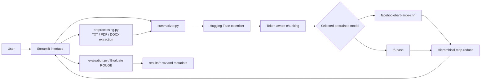
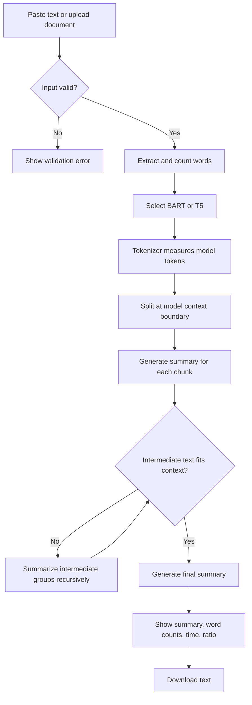
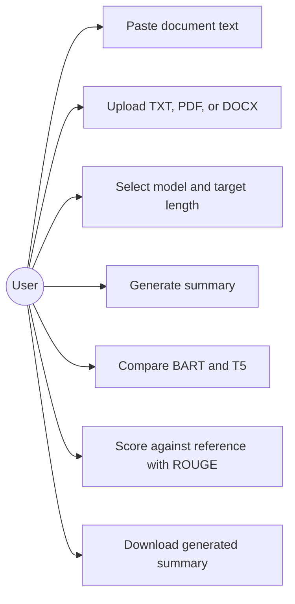

# System architecture and workflow

## Component architecture

## Data-flow diagram

## Use-case diagram

## Workflow notes

The UI delegates parsing to `preprocessing.py`; the same validated source string
then goes to one or both summarizers. Each summarizer uses its own tokenizer and
context limit. Map-reduce covers every token chunk and recursively reduces
intermediate summaries. ROUGE is computed only after generation when a non-empty
human reference is provided. The evaluation CLI instead accepts paired rows and
runs the same rows through both models before writing per-example and aggregate
CSV files.
